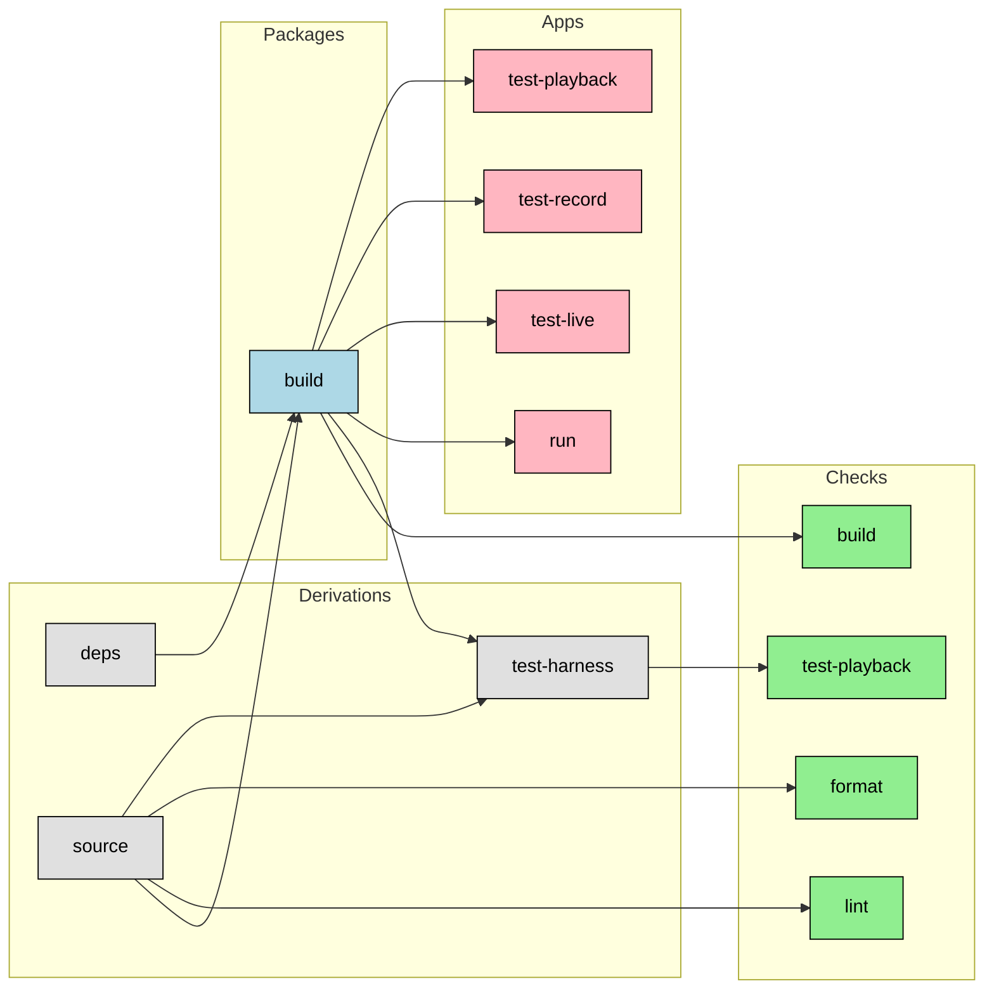

<project>
PureScript AE

An Algebraidc effect system (based on purescript-run) that combines the concepts of free monads and free applicatives to achieve a DSL where developers can have parts of their programs run in parallel.
```

</project>
<guidance>
<general>
# General Software Development Rules

## Core Principles

- **Brutal Honesty**: Reject bad ideas directly. Bad ideas compound into technical debt. User prefers you point out problems with their suggestions.

- **Delete Completely**: Delete unneeded code entirely, don't comment out. Version control preserves history.

- **Fail Fast**: Crash immediately when required inputs missing. No `|| true`, no `${VAR:-default}` for required vars, no fallback defaults, no empty catch blocks. Use `set -euo pipefail` in bash, `${VAR:?error}` for required env vars. Make invalid states unrepresentable. Defensive fallbacks hide bugs; loud crashes force fixes.

- **Code Consolidation Before Creation**: Search existing codebase before writing new functions. Search-first prevents duplication.

- **Document Technical Debt**: Record debt in specs with remediation plans.

- **Explicit Types**: Use Either/Maybe/Result over exceptions.
- **Test Outcomes**: Verify results, not "didn't crash". Check actual effects (files, network), not logs. NEVER generate expected values within tests—verify against independent expectations. Circular validation always passes and verifies nothing.
- **Assume Failure**: Always verify with tests.
- **Immutable First**: Immutability prevents bug classes.
- **Type Safety**: Make invalid states unrepresentable. Nest co-dependent properties: `{both:: Maybe {a: String, b: String}}`
- **Parse, Don't Validate**: Transform at boundaries. Parse once, let types enforce invariants.
- **Effects at Edges**: Pure core, effects at boundaries.
- **DRY**: One authoritative representation per piece of knowledge.
- **No File Backups**: Rely on git.
- **Prefer Functional**: Gleam, PureScript, Elm, Haskell eliminate mutable state bugs.
- **Prefer Libraries**: Search existing libraries first.
- **Prefer Static Types**: Gleam, PureScript, Elm, Haskell, Rust catch errors at compile time.
- **Single Approach**: One pattern per problem class.
- **Single Responsibility**: One thing well.
- **Minimal Comments**: Self-documenting code. Comments only for: module docs, why non-obvious choices, safety invariants. Code=HOW, types=WHAT, comments=WHY.
- **No Hard Coded Paths**: Avoid hard coded paths.
- **Predictable Output Locations**: All command output goes to `out/<command-name>/` directories. Never use temp directories or `mktemp`—predictable locations make debugging trivial; ephemeral locations make it impossible.
- **No Environment Variables**: Prefer explicit CLI arguments. Accept from external libraries, never add to your own code.
- **Suggest Guidance Improvements**: Add learnings to guidance when overcoming hurdles.
- **No Backwards Compatibility**: Force clean breaks. Never add fallback logic, compatibility layers, or version detection unless explicitly requested by the user. Users pin to specific versions via Nix—they can stay on old versions indefinitely. Breaking changes force issues to surface immediately rather than hiding as silent failures. Defensive compatibility code accumulates as permanent baggage and obscures intent. When requirements change, make loud breaking changes that fail fast.
- **Rigorous Tooling**: Configure ALL tools through flake.nix. Run via `nix flake check` or `nix run .#format-fix`.
- **No Code in Plans**: Planning docs shouldn't have untested code.
- **No Documentation**: Never create documentation unless explicitly requested by the user. Code and tests represent intent.
</general>
<nix>
# Nix

We use Nix flakes for reproducible builds with sandboxed builds. Treat Nix as primary build system. We use the Determinate version of Nix.

- **Use checks**: `nix flake check` runs all checks (lint, format, build, test-playback). Add ALL targets as checks. Wait for full command completion before reporting success — stages include: deps, source, lint/format, build, test-harness.
- **Use run**: We use run targets exclusively for side effects (deployment, formatting code in place, live tests, recording fixtures). Test execution apps are aggregate targets (`.#test-live`, `.#test-record`, `.#test-playback`) that support filtering via test framework CLI arguments (e.g., Cucumber: `nix run .#test-live -- features/auth-flow.feature`, `nix run .#test-record -- --tags @smoke`). Playback tests are pure verification and run via `nix flake check` or `nix build .#checks.<system>.test-playback`.
- **Make apps**: The default app should start the production application. So we can just `nix run`
- **Make dev**: Add a dev target so we can `nix run .#dev`  to uniformly start development servers etc. We can use process compose to add multiple services if needed.

## Core Principles

- **Single Source for Dev Commands**: flake.nix ONLY. No package.json scripts, Makefile, justfile, etc. All dev operations through `nix flake check`, `nix build`, or `nix run`.

- **Use Platform Integrations**: purs-nix (PureScript+JS), uv2nix (Python), buildNpmPackage (JS).

- **No Network in Builds**: No npm install, cargo build, pip install, wget/curl in build targets. Use derivations (mkSpagoDerivation, buildNpmPackage) that fetch dependencies reproducibly. Network calls fine in impure `nix run` targets. Example: `ln -s ${deps}/node_modules ./node_modules`

- **Hash Dependencies Properly**: NEVER use `lib.fakeHash` or empty strings for `npmDepsHash` in buildNpmPackage. fakeHash breaks reproducibility by allowing builds to succeed with incorrect dependency hashes, defeating Nix's content-addressed caching. Calculate the actual hash: `nix run nixpkgs#prefetch-npm-deps -- package-lock.json`. This command reads your lockfile and outputs the correct hash to use in `npmDepsHash =`. Without proper hashes, builds are non-deterministic—Nix cache misses, CI failures, and team environment drift follow. The workflow: (1) update package-lock.json, (2) run prefetch-npm-deps, (3) paste the hash into flake.nix.

- **Separate Inputs**: `deps` and `source` are siblings. `build` depends on both; `test-harness` depends on both; `lint` and `format` run from `source`. This separation enables caching and clearer responsibilities. Copy only files needed for each stage: exclude test fixtures from `source` (provided separately to test harness at runtime), exclude test code from `build`, include only manifests/lockfiles in `deps`. Selective copying maximizes cache hits—changing a test file shouldn't invalidate the build cache. This is why fail-fast assertions are critical: silent fallbacks hide when files were omitted from a derivation, breaking reproducibility.

- **Use Result Symlink**: Debug multi-stage builds by inspecting the `result` symlink after each stage.

- **No Fallbacks**: Crash explicitly when requirements missing. No `|| true`, no conditional checks that skip required steps, no version detection, no compatibility shims. Silent fallbacks hide missing derivation inputs and break Nix caching/reproducibility. Users can pin to old flake versions via lock files—backwards compatibility is unnecessary baggage. See general.md fail-fast principle.

- **Git Tracking (Policy)**: Nix can build from your working tree locally. Our policy is to require staged/committed changes for CI and shared reproducibility. Never add fallback logic for unstaged files—fail loudly if required files aren't tracked.

- **Copying/Symlinking**: Symlink read-only deps (`ln -s ${deps}/node_modules ./`). Copy when modifying (`rsync -a --no-perms --no-owner --no-group ${source}/src ./`). Never `cd` into derivation outputs (immutable).

- **Command Output Organization**: All command output (test results, build artifacts, logs, CI reports) goes to `out/<command-name>/` directories. Create subfolders like `out/<command-name>/<sub-part>/` as needed. Add `out/` to `.gitignore`. Never use temp directories or `mktemp`—ephemeral locations make debugging impossible. Commands running in the Nix store require specified output locations outside the store. Predictable locations mean you always know where to look when things fail.

- **No FHS Assumptions**: Declare all tools via Nix. No `/usr/bin` assumptions.

- **Secrets**: Use SOPS with age encryption. Never commit secrets, .env files, or credentials.

- **Use direnv (nix-direnv)**: Prefer `nix-direnv` and a simple `.envrc` with `use flake .` so the dev shell auto-loads and tracks `flake.nix`/`flake.lock`.

- **shell.nix**: Add backwards compatible shell.nix pointing to flake

---

## Local Development Workflow

- **Link Local Flakes with --override-input**: When developing multiple flakes together, use command-line overrides instead of editing flake.nix. This doesn't touch your lockfile: `nix develop . --override-input libA path:../libA --override-input toolkit path:../toolkit`

 - **Automate with direnv**: Use `nix-direnv` and a minimal `.envrc`:
  ```bash
  use flake .
  ```

---

## Flake Organization

- **Flakes as Entry Points**: Keep lightweight. Call traditional Nix code.
- **Use flake-parts**: Modular organization. [flake-parts docs](https://flake.parts/)
 - **Avoid IFD**: Avoid import-from-derivation (IFD) during evaluation; if unavoidable, isolate and document.
- **Systems**: Target systems are `x86_64-linux` and `aarch64-darwin`. Locally, you don’t need to specify a system — Nix selects the host platform automatically. CI should evaluate/build both.
- **Binary Cache**: CI uses Determinate’s Magic Nix Cache and publishes to FlakeHub; no manual `nixConfig.substituters` is required for CI. If we later need a persistent org-wide cache for local reuse of CI outputs, consider adding one (Cachix/Attic) and wiring substituters.
- **Always Use inputs.follows**: Unify dependencies. Pattern: `inputs.nixpkgs.follows = "nixpkgs"`
- **Avoid with**: Use explicit imports or inherit.
- **Checks Must Produce $out**: All checks must `touch $out`
- **Formatting via treefmt-nix**: Standardize on `treefmt-nix` for all languages (including Nix via `nixfmt-rfc-style`). Set `perSystem.formatter = config.treefmt.build.wrapper` so `nix fmt` runs the full formatter suite. Expose `checks.format = config.treefmt.check` for verify-only and provide an `apps.format-fix` to apply fixes.
- **Lint**: Add `statix` and `deadnix` as checks
- **Packages for Build Artifacts Only**: Only expose final runtime artifacts as packages (build). The test harness is an internal derivation consumed by checks/apps. Verification steps (lint, format, test-playback) are checks only — not packages.
- **Internal Derivations**: Keep intermediate build stages (deps, source, test-harness) as local derivations — not exposed in `packages` output. They're cached automatically but users never access them directly.
- **Apps for Side Effects Only**: Apps should exclusively handle side effects (recording fixtures, live tests, deployment, formatting in place). Pure verification belongs in checks, not apps. Dev tools (dev, format-fix) that operate on the external working directory only need tools (independent of `deps`/`source`), while apps that need the built application (run, test-record/live) depend on `build`.
 - **Expose Reuse Surfaces**: When applicable, expose `overlays`, `nixosModules`, and `devShells` in flake outputs to support downstream reuse.
 - **Package UX**: Set `meta.mainProgram` on packages so `nix run .#<package>` works without custom apps.
- **Share Tools Between devShell and Apps**: Implement `.#format-fix` as an app that depends on the same toolset as your `devShells` (e.g., `nixfmt-rfc-style`, `treefmt`). Don’t depend on `devShell` directly; instead, define a shared list of tools used by both the dev shell and the app to keep them in sync.

### Formatting (multi-language)

- **Unify with treefmt-nix**: Use `treefmt-nix` to run multiple formatters (Prettier, nixfmt, shfmt, black, isort, rustfmt, taplo, stylua, etc.).
- **Prettier via Nix**: Provide Prettier from Nix (e.g., `pkgs.nodePackages.prettier`) to avoid network access. Keep `.prettierrc*` in the repo.
- **Checks vs Fix**: Wire a `checks.format` for verification (no changes) and an app `.#format-fix` to apply changes (`treefmt --fix`).
- **Share Tools**: Use the same tool wrapper in `devShells.default` and `apps.format-fix` so CLI and CI behave consistently.

Wiring outline (flake-parts):
- Import `treefmt-nix.flakeModule`. Set `perSystem.formatter = config.treefmt.build.wrapper` so `nix fmt` runs all formatters (including `nixfmt-rfc-style` for Nix).
- Configure `config.treefmt.programs` for the languages you use (e.g., Prettier, shfmt, black, rustfmt).
- Expose `checks.format = config.treefmt.check` (verification only).
- Put `config.treefmt.build.wrapper` in `devShells.default` so `treefmt` is available.
- Provide an `apps.format-fix` that runs `treefmt --fix` with the wrapper on PATH.


### Tool Groups and Toolchains (concise)

- **Single source of truth**: Define tool lists once and reuse across devShell, checks, and apps.
- **Groups**:
  - fmtTools: treefmt wrapper, nixfmt-rfc-style, Prettier.
  - lintTools: statix, deadnix, eslint (as needed).
  - devTools: nodejs, pnpm, process-compose, watchexec (what your dev app needs).
  - buildToolchains: per stack (e.g., PureScript: purescript, spago, esbuild; JS: nodejs, esbuild).
- **Usage**:
  - devShells.default = devTools + fmtTools + lintTools (+ buildToolchains if used interactively).
  - apps.dev = devTools only; add buildToolchains only if your dev flow compiles/bundles.
  - apps.format-fix = fmtTools only (no lint or build tools).
  - checks.format = treefmt check (no modifications).
  - Build derivations declare buildToolchains in nativeBuildInputs/buildInputs (hermetic; no network).
- **purs-nix**: Prefer purs-nix to build PureScript inside derivations. Include purescript/spago/esbuild in devShell only for interactive convenience; keep builds pure.

## Testing

- **NixOS Integration Tests**: Use `pkgs.testers.runNixOSTest`. [Tutorial](https://nix.dev/tutorials/nixos/integration-testing-using-virtual-machines.html)

### Aggregate Test Targets with CLI Pass-through

- Use aggregate test targets (`.#test-live`, `.#test-record`, `.#test-playback`) that accept test framework CLI arguments for filtering
- Filtering happens via the test framework (Cucumber, pytest, jest, etc.), not via separate Nix targets
- Single aggregate check: `test-playback` runs all tests in deterministic mode
- Apps pass all arguments through to the test framework: `"$@"`

**Examples:**
```bash
# Run specific feature files
nix run .#test-playback -- features/auth-flow.feature
nix run .#test-live -- features/data-export.feature

# Filter by tags
nix run .#test-live -- --tags @smoke
nix run .#test-record -- --tags "@critical and @healthcare"

# Filter by scenario name
nix run .#test-playback -- --name "User registration"

# Combine filters
nix run .#test-live -- features/auth-flow.feature --tags @smoke
```

**Implementation pattern:**
```nix
test-live = pkgs.writeShellApplication {
  name = "test-live";
  text = ''
    export REAL_INTEGRATION=true
    ${test-framework}/bin/test-runner "$@"  # Pass all args to test framework
  '';
};
```

## Dependency Updates

- **Automate Updates**: Use [update-flake-lock](https://github.com/DeterminateSystems/update-flake-lock) for weekly PRs.

---

## Build Pipeline

Pipeline: (deps + source) → build; from source: lint/format; from build+source: test-harness



**Visual Legend:**
- Gray: Internal derivations (cached but not exposed as packages)
- Light blue: Packages (runtime artifacts only: build)
- Light green: Checks (verification only: lint, format, build, test-playback)
- Light pink: Apps (side effects only)
  - Tools-only: dev, format-fix (operate on external files)
  - From build: run, test-live, test-record, test-playback (need compiled app)

**Test Execution:**
Test targets are aggregate commands (test-live, test-record, test-playback) that accept test framework CLI arguments for filtering. This design allows flexible test selection via the test framework's native filtering (tags, names, files) without creating separate Nix targets. Run all tests by default, or filter to specific features/scenarios by passing arguments.

- Use aggregate test targets with CLI argument pass-through for filtering
- **Playback tests** (pure verification): Run via `nix flake check` (auto-selects host system) or `nix build .#checks.<system>.test-playback` for CI/cross-system. Interactive: `nix run .#test-playback -- [cucumber-args]`
- **Record/live tests** (side effects): `nix run .#test-live -- [test-args]` and `nix run .#test-record -- [test-args]`

**Filtering examples:**
```bash
# Run specific feature
nix run .#test-playback -- features/auth-flow.feature

# Filter by tags
nix run .#test-live -- --tags @smoke

# Filter by scenario name
nix run .#test-record -- --name "User login"
```

**Stages:**
1. **deps**: Dependency manifests/lockfiles only. Excludes sources.
2. **source**: Copy sources (no compilation). Excludes large test data.
3. **lint/format**: Static checks on source tree.
4. **build**: Compile/package from source.
5. **test-harness**: Assemble test harness and validate test code (compilation, syntax, dry-run). Does not
  execute test scenarios - scenario execution happens via apps.

**Outputs:**
- Internal Derivations (cached, not exposed): deps, source, test-harness
- Packages: build (user-facing runtime build output only)
- Checks: lint, format (from source), build (from build package), test-playback (from test-harness)
- Apps: `nix run` (default), `.#dev`, `.#format-fix`, `.#test-live`, `.#test-record`, `.#test-playback` (side effects only)

**Note:** Internal derivations like `deps`, `source`, and `test-harness` are cached by Nix but not exposed in `packages` output. They're purely intermediate build stages. Lint, format, and test-playback are checks only - they verify code quality and correctness but aren't user-facing build artifacts. Apps are exclusively for side effects and draw on the minimal tools they need:
- **Tools-only**: `dev`, `format-fix` - operate on external working directory; do not depend on `deps`/`source`
- **From build** (need built app): `run`, `test-live`, `test-record`, `test-playback` - need the compiled application

**Source Filtering:**
Use `pkgs.lib.fileset` for include/exclude. Example (exclude heavy fixtures, not test sources):
```nix
src = pkgs.lib.fileset.toSource {
  root = ./.;
  fileset = pkgs.lib.fileset.difference
    (pkgs.lib.fileset.fromSource ./.)
    (pkgs.lib.fileset.unions [
      (pkgs.lib.fileset.glob ".git/**")
      (pkgs.lib.fileset.glob "dist/**")
      (pkgs.lib.fileset.glob "node_modules/**")
      (pkgs.lib.fileset.glob "test/fixtures/**")
    ]);
};
```
</nix>
<purescript>
# PureScript

## FFI (Foreign Function Interface)

**Principles:**
- NEVER import FFI as pure - JavaScript can throw. Use `EffectFn*` types (`EffectFn0`, `EffectFn1`, `EffectFn2`, etc.) matching JS argument count, then wrap with `runEffectFn*`
- Keep JS minimal - simple stubs over external libraries
- Never use `Foreign` type - model with proper PureScript types
- Use `EffectFn*` for multi-arg JS functions (avoids currying)
- Promises: Return `fromAff`, receive as `Effect (Promise a)` → `Control.Promise.toAff`

**Pattern:**
```javascript
import {run} from Library
export const importRun = run
```
```purescript
foreign import importRun :: EffectFn2 String String String
run = runEffectFn2 importRun
```

## Advanced Patterns

**Existential Types**: [PureScript Exists](https://github.com/purescript/purescript-exists) - "forget" type parameters for heterogeneous collections, type-erased APIs, plugin systems.

**Pattern:**
```purescript
import Data.Exists as Data.Exists
data Wrapper' f = Wrapper' { value :: forall a. f a, handler :: f a -> String }
type Wrapper = Data.Exists.Exists Wrapper'
mkWrapper val handler = Data.Exists.mkExists (Wrapper' { value: val, handler })
runWrapper w = Data.Exists.runExists (\(Wrapper' {value, handler}) -> handler value) w
```

## Error Handling

- Use Either/Maybe for all errors - never throw exceptions or use unsafe functions.

## Import Standards

- Import modules with qualified aliases: `import Data.Maybe as Data.Maybe`
- Use fully qualified names: `Data.Maybe.fromMaybe`
- Exceptions: Symbol imports `import Type.Row (type (+))`, `import Prelude`
- Remove duplicates and unused imports

## Safety

**Ban all "unsafe" functions** - Never bypass type safety. Fix types instead.

**Banned:** `Partial`, `unsafePartial`, `unsafeCoerce`, `unsafePerformEffect`, `unsafePerformAff`, `crashWith`

**Use:** Either/Maybe (not partials), Effect/Aff/Run.Run (not unsafePerform*), proper conversion (not coerce)

## Debugging

**Type Holes**: Use `?placeholder` to ask compiler what type fits. Shows matching functions via type-directed search. One hole per compilation.

**Runtime**: `purescript-debug` for development (triggers `DebugWarning`):
- `spy "label" value` or in a compose `<<< (spy "label") <<<` - logs and returns value
- `spyWith fn value` - transform before logging

Remove debug functions before production.

---


- **Uncurried FFI**: Use `Fn2`-`Fn10` for performance-critical FFI. Avoids currying overhead.

---

## Web UI
[Halogen](https://github.com/purescript-halogen/purescript-halogen) with ELM-style central state (not component architecture). Reference: [Halogen Realworld](https://github.com/thomashoneyman/purescript-halogen-realworld)

## Libraries

Search [Pursuit](https://pursuit.purescript.org) by name or type signature.

**Key:** Argonaut (JSON), Affjax (HTTP), aff (async), js-promise-aff (Promise/Aff FFI), effect, run (algebraic effects), Halogen (web UI)

## Nix

Use purs-nix (jamesjwood/purs-nix, json-errors branch) for builds. Use purescript-overlay for tooling (spago@next with yml configs). No spago for builds. IDE: `purs-nix compile --json-errors`

## Effects & Testing

Type classes per effect. Use monad transformers or Run library. Test modes: see [testing.md](./testing).
</purescript>
<testing>
# Testing

## BDD-Style Integration Tests

- Test externally observable behavior only (public APIs, UIs, CLIs)
- Verify effects (files, DB changes) directly; avoid mocks
- CI runs Playback only; tests execute against built artefacts
- Output to `out/test/{scenario}/` for logs, reports, artifacts (never temp directories; debugging requires persistent locations)
- NEVER generate expected values within tests. Tests must verify against independently-established expectations (fixtures, known constants). Circular validation (calling same function twice, copying implementation into test) always passes and verifies nothing. Not acceptable even temporarily—provides false confidence.

## Modes

- Playback (pure): `nix flake check` or `nix run .#test-playback -- [test-args]`
  - Offline, deterministic, uses fixtures
  - Missing fixtures must fail the test immediately (fail-fast validates derivation inputs are complete; silent skips hide when files were omitted from derivations, breaking Nix caching and reproducibility)
  - Interactive playback app supports test framework CLI args for filtering
- Live (impure): `nix run .#test-live -- [test-args]`
  - Hits real endpoints
  - Supports test framework CLI args (e.g., `--tags @smoke`, `features/auth-flow.feature`)
- Record (impure): `nix run .#test-record -- [test-args]`
  - Regenerates fixtures from live services
  - Supports test framework CLI args for selective recording
  - Stage new fixtures with `git add` before running `nix flake check` (Nix only includes staged files)
 - All modes run the same test harness built at the test stage

## Feature Suites

- One feature file → one suite (kebab-case): `auth-flow`, `data-export`
- Files: `test/features/<feature>.feature.md`
- Fixtures: `test/fixtures/<feature>/`

## Nix Targets

Aggregate test targets with test framework CLI pass-through for filtering:

- **Playback** (deterministic): `nix run .#test-playback -- features/auth-flow.feature`
- **Live** (real endpoints): `nix run .#test-live -- --tags @smoke`
- **Record** (capture fixtures): `nix run .#test-record -- --name "User login"`
- **CI**: `nix flake check` (runs all playback tests)

**Filtering examples:**
```bash
# Run specific feature
nix run .#test-playback -- features/auth-flow.feature

# Filter by tags
nix run .#test-live -- --tags "@critical and @healthcare"

# Filter by scenario name
nix run .#test-record -- --name "User registration"

# Run all tests (default)
nix run .#test-live
```

## Tools

- BDD Markdown for specs; JS/TS step defs
- Keep side-effect calls minimal; reuse results for multiple assertions

## Retro-fitting

- Capture current correct output, write BDD tests, confirm pass
- Introduce a temporary fault to ensure tests fail appropriately
</testing>
</guidance>

This file is generated, do not edit it directly. Edit either the project specific information in [agents.yml](./agents.yml) or the [company guidance](https://github.com/Cambridge-Vision-Technology/agen/wiki) and then rerun `agen`
To install the agen tool `nix profile add github:Cambridge-Vision-Technology/agen`